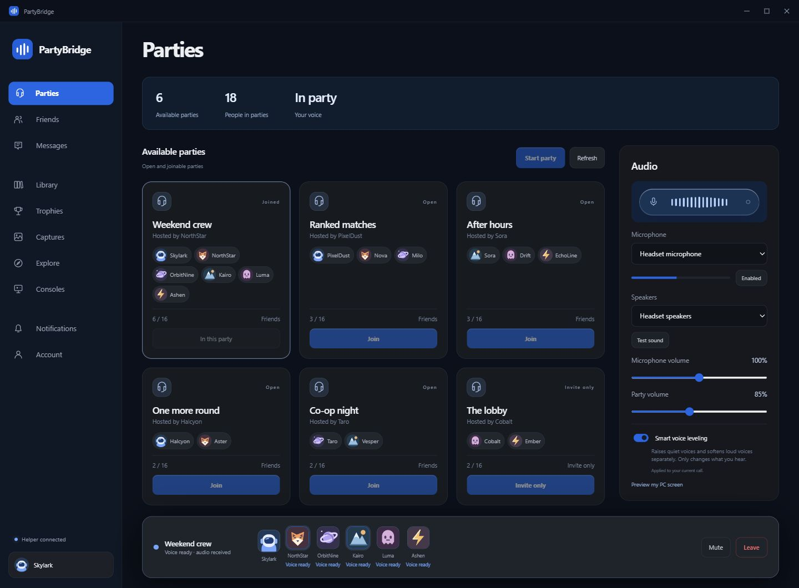

<p align="center">
  
</p>

<h1 align="center">PartyBridge</h1>

<p align="center">PlayStation parties, voice chat and friends on Windows.</p>

<p align="center">
  
  
  <a href="LICENSE"></a>
</p>

<p align="center">
  <a href="#install">Install</a> |
  <a href="#features">Features</a> |
  <a href="#run-from-source">Run from source</a> |
  <a href="docs/BUILDING.md">Build instructions</a> |
  <a href="CONTRIBUTING.md">Contributing</a>
</p>



<p align="center"><sub>Demo with fictional profiles and party activity.</sub></p>

PartyBridge is an unofficial desktop client for PlayStation parties. Its voice helper runs in the background, and packaged builds include the runtimes they need. You can open the app directly without a browser, terminal or separate Node.js installation.

## Features

| Area         | Available features                                                                                           |
| ------------ | ------------------------------------------------------------------------------------------------------------ |
| Parties      | Discover, create, join and leave parties, with automatic updates and notifications for newly opened parties. |
| Voice        | Group voice, mute, microphone and speaker selection, volume controls and smart voice leveling.               |
| Participants | Per-device readiness, profile details and individual volume controls.                                        |
| Social       | Friends, conversations and messaging.                                                                        |
| Account      | Library, trophies, captures, notifications and other account pages.                                          |
| Share Screen | Watch a PS5 Share Screen from your party.                                                                    |
| Desktop      | Saved login protected by Windows encryption, system tray support and local logs.                             |

PC screen broadcasting is not implemented. The PC capture preview stays local.

This is an early release using unofficial PlayStation interfaces. Sony service changes can affect compatibility. Transport readiness and incoming audio do not establish that every remote participant can hear your microphone.

## Install

Download the Windows installer or portable ZIP from [release 0.1.0](https://github.com/RinnetGroup/PartyBridge/releases/tag/v0.1.0). The repository and its release downloads are currently private; sign in with an account that has repository access.

| File                                  | Use                                                                    |
| ------------------------------------- | ---------------------------------------------------------------------- |
| `PartyBridge-Setup-<version>-x64.exe` | Windows installer with Start menu and desktop shortcuts.               |
| `PartyBridge-<version>-x64.zip`       | Portable app. Extract the whole ZIP and open `PartyBridgeRelease.exe`. |
| `SHA256SUMS.txt`                      | SHA-256 checksums for verifying downloaded files.                      |

Packaged builds target Windows x64 and include Electron, Node.js and the voice dependencies. The initial installer is unsigned.

After installing, open **PartyBridge Release**, choose **Connect account**, and follow the Sony sign-in flow. The app saves the refresh credential using Windows-protected encryption. Signing out removes the saved credential.

If voice network checks receive no replies, **Audio > Voice network access** opens an optional UDP firewall setup. It explains the scope and requires administrator approval. It does not fix Sony API errors or unavailable party bridges.

Closing the window keeps the app in the system tray. Use the tray's **Quit PartyBridge** action or **Ctrl+Q** to stop the helper and leave voice.

[Full installation, sign-in and troubleshooting instructions](docs/INSTALL.md)

## Run from source

Use Windows x64 and **Node.js 24.18.0**.

```powershell
git clone https://github.com/RinnetGroup/PartyBridge.git
cd PartyBridge
npm ci
npm start
```

`npm ci` installs the development Electron binary and applies the reviewed Sony WebRTC compatibility changes. No Python, C++ compiler or manual dependency edits are required.

To use the browser interface instead:

```powershell
npm run start:web
```

Open the loopback address printed by the helper. The desktop app chooses its own private helper port.

## Build and test

```powershell
npm test
npm run check
npm run format:check
npm run release:build
npm run release:verify
```

Build outputs go to `dist/`. These commands do not upload artifacts or publish a GitHub release.

The offline tests cover local API routes, voice signaling, audio timing and mixing, participant leave/rejoin behavior, saved login and the patched WebRTC packet/role behavior. Live Sony compatibility still needs testing with consenting participants.

The **Check source** workflow runs on pushes and pull requests. **Build Windows release** creates workflow artifacts when run manually or from a version tag. Both use read-only repository permissions; neither publishes a release.

[Build and release guide](docs/BUILDING.md) | [Architecture](docs/ARCHITECTURE.md)

## Project structure

| Folder               | Purpose                                                          |
| -------------------- | ---------------------------------------------------------------- |
| `electron/`          | Desktop windows, tray, saved login and helper lifecycle.         |
| `server/`            | Local HTTP API, PlayStation requests, voice and screen viewing.  |
| `protocol/`          | Bridge and participant control channels.                         |
| `public/`            | Interface, microphone capture and audio playback.                |
| `test/`              | Offline tests and fixtures.                                      |
| `scripts/`, `build/` | Dependency setup, verification and Windows packaging.            |
| `patches/`           | Reviewed compatibility changes for the pinned WebRTC dependency. |

## Privacy and development builds

The helper listens on loopback. The renderer does not receive saved login credentials, and diagnostics exclude tokens, raw SDP and media recordings. Review logs before sharing them.

The release profile is `%APPDATA%\PartyBridge Release`. Source development uses `%APPDATA%\PartyBridge Release Dev`. The original local working app has a separate profile, executable and shortcuts.

Credentials, logs, captures, extracted applications and private research are excluded from this repository. Never post NPSSO values, tokens or saved login files in an issue.

## Contributing

Read [CONTRIBUTING.md](CONTRIBUTING.md) before submitting changes. Include the behavior changed and the checks you ran. Use fictional accounts and fixtures in tests.

For bugs, include the app version, device types involved, the approximate failure time and the visible error. Report sensitive issues according to [SECURITY.md](SECURITY.md).

## License

[MIT](LICENSE). Third-party components retain their own licenses; see [THIRD-PARTY-NOTICES.txt](THIRD-PARTY-NOTICES.txt).

PartyBridge is an independent project and is not affiliated with or endorsed by Sony Interactive Entertainment.
